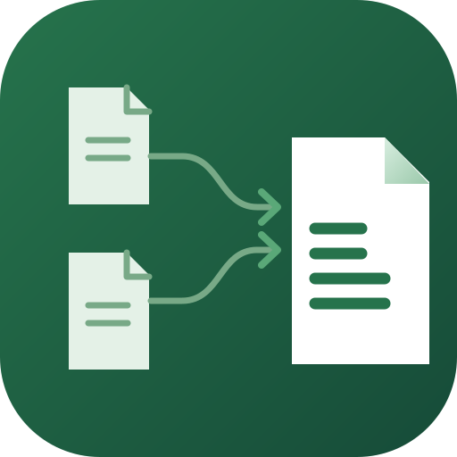
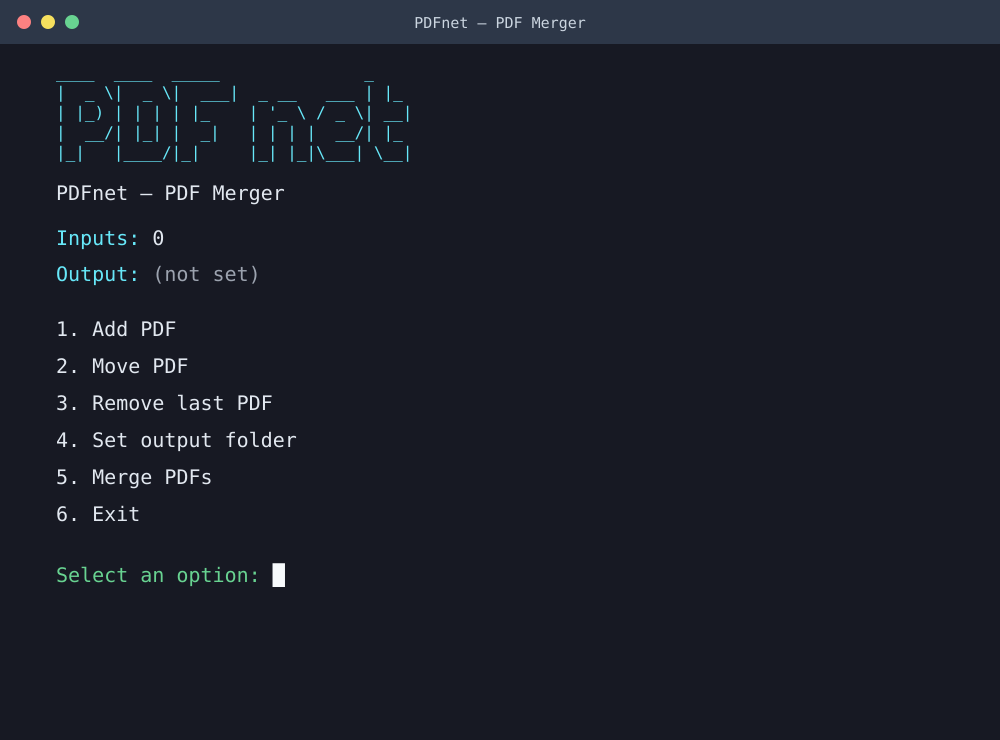
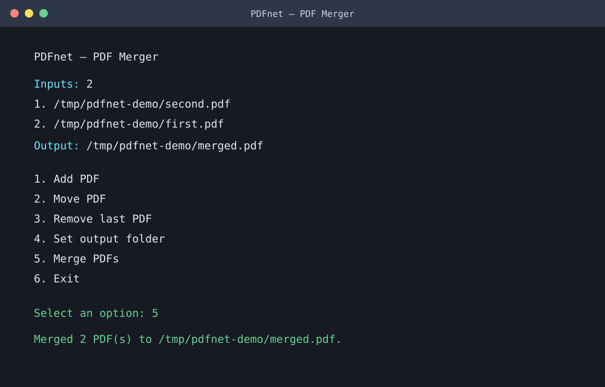
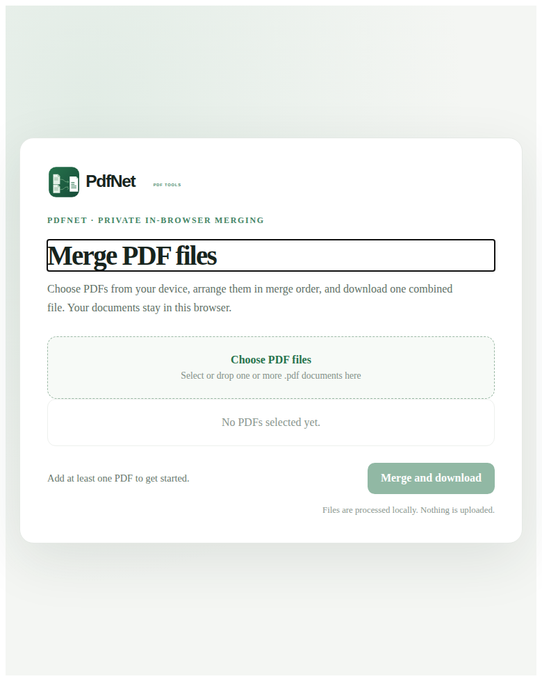
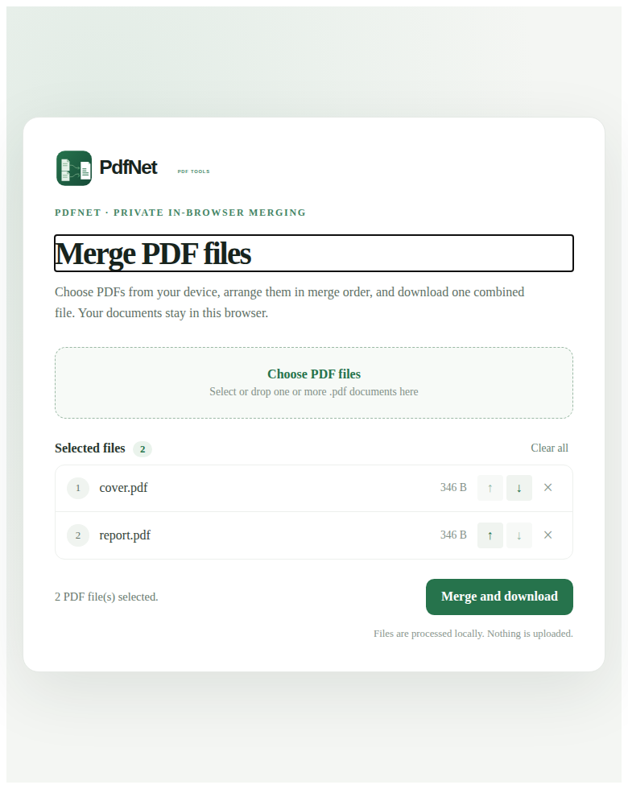
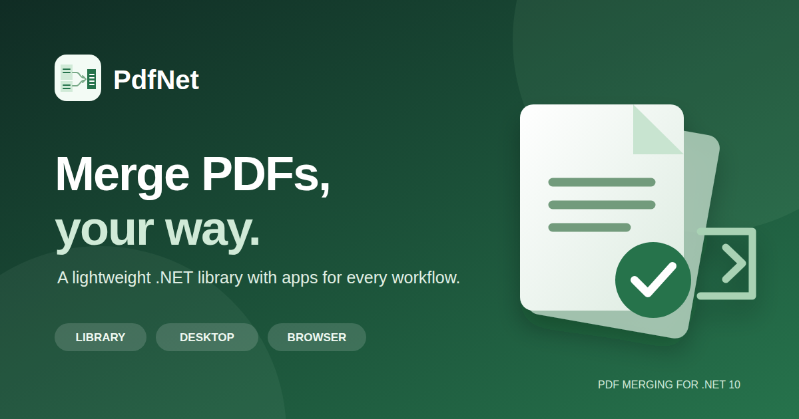

#  pdfnet

A dependency-free .NET 10 C# library and apps for merging PDF documents.

[](https://github.com/alexhedley/pdfnet)
[](https://github.com/alexhedley/pdfnet)
[](https://github.com/alexhedley/pdfnet)
[](https://github.com/alexhedley/pdfnet)
[](https://github.com/alexhedley/pdfnet)
[](https://github.com/alexhedley/pdfnet)
[](https://github.com/alexhedley/pdfnet)

[](https://dotnet.microsoft.com/apps/aspnet/web-apps/blazor)
[](https://learn.microsoft.com/dotnet/desktop/wpf/)
[](https://learn.microsoft.com/dotnet/desktop/winforms/)
[](https://learn.microsoft.com/windows/apps/winui/)
[](https://github.com/features/copilot)

[](https://github.com/alexhedley/pdfnet/actions/workflows/ci.yml)
[](https://github.com/alexhedley/pdfnet/actions/workflows/packages.yml)
[](https://github.com/alexhedley/pdfnet/actions/workflows/pages.yml)
[](https://github.com/alexhedley/pdfnet/actions/workflows/release.yml)
[](https://github.com/alexhedley/pdfnet/actions/workflows/dependency-check.yml)
[](https://github.com/alexhedley/pdfnet/actions/workflows/owasp-dependency-check.yml)
[](https://alexhedley.github.io/pdfnet/)
[](https://alexhedley.github.io/pdfnet/docs/)
[](https://alexhedley.github.io/pdfnet/dependency-check/)

## Contents

- [Library usage](#library-usage)
- [Applications](#applications)
- [Brand assets](#brand-assets)
- [Build and test](#build-and-test)
- [Local packaging, installation, and running apps](docs/README.md#pack-locally)
- [Architecture](docs/ARCHITECTURE.md)

## Applications

Explore the [marketing site and app usage guides](https://alexhedley.github.io/pdfnet/site/).
Its self-contained HTML/CSS/JavaScript source is in [`site/`](site/README.md).

### Console app

The repository includes a terminal interface for combining PDFs:

```bash
dotnet run --project src/PdfNet.Tui
```

Add one or more PDF paths, choose an output folder, and select **Merge PDFs**.
Use **2. Move PDF** to enter a PDF's current number and its new position in the
displayed list. The remaining options are **3. Remove last PDF**,
**4. Set output folder**, **5. Merge PDFs**, and **6. Exit**.
The app validates the inputs and reports merge errors without closing the menu.
Caught merge exceptions appear in red in the terminal; redirected output stays
plain text.
An ASCII banner welcomes you at startup. Cyan **Inputs/Output** labels separate
the current selection from the menu, and an unset output is shown in grey.
The **Select an option:** prompt is green and resets before you enter a choice.
After an action finishes, including all path or ordering prompts, the terminal
clears the previous screen and redraws the banner, leaving the latest action's
result visible above the updated menu.
Action messages appear in yellow, separated from the banner by a blank line;
merge exceptions remain red.
Redirected output preserves the full transcript without screen-control codes.
Both path prompts accept paths with or without matching single or double quotes
and ignore whitespace outside the quotes. Windows paths can use any accessible
drive, for example `"D:\PDF files\input.pdf"`. Relative paths are resolved from
the app's current working directory.

Enter an existing folder such as `D:\docs`, not a filename. The TUI saves
`merged.pdf` inside that folder; the Output line shows the complete destination.
Invalid folder entries leave any previously chosen destination unchanged.
Inputs must be readable, and the folder and any existing destination
must be writable and not locked by another app. An access-denied error is a
filesystem permission or file-access issue, not a restriction to the C: drive.
When debugging, Visual Studio may break when an exception is thrown even though
the TUI catches it; continue execution to see the menu's error message.
The TUI rejects a destination that matches a selected input PDF.

#### Merge without the menu

Pass individual input files in merge order and an existing output folder:

```bash
pdfnet --output ./results "cover page.pdf" report.pdf
dotnet run --project src/PdfNet.Tui -- --output ./results "cover page.pdf" report.pdf
pdfnet --help
```

`-o` is an alias for `--output`. The result is `merged.pdf` in that folder.
Use `--` before input filenames beginning with `-`. Shell quotes protect spaces;
do not include literal quote characters in arguments supplied programmatically.
Success exits with code 0; invalid arguments or merge failures report to stderr
and exit with code 1. No arguments opens the interactive menu.
The menu shows the app version; use `pdfnet --version` to print it directly.




Animated walkthroughs: [interactive menu](docs/screenshots/pdfnet-tui.gif) and
[command-line mode](docs/screenshots/pdfnet-cli.gif).
The VHS recipes are [`pdfnet-tui.tape`](docs/tapes/pdfnet-tui.tape) and
[`pdfnet-cli.tape`](docs/tapes/pdfnet-cli.tape); both use
`docs/examples/sample.pdf`.

#### Install the terminal global tool

The terminal app is also packaged as a .NET global tool. Download the
`PdfNet.Tui` and `PdfNet` NuGet packages from a GitHub release into the same
directory, then install from that local package source:

```bash
dotnet tool install --global PdfNet.Tui --version 0.1.0 --add-source ./downloads
pdfnet
```

Replace `0.1.0` with the release version. The tool requires the .NET 10 runtime.

### Merge a folder of PDFs

The .NET 10 file-based app merges all top-level `.pdf` files in a directory in
case-insensitive filename order. It writes `merged.pdf` into that directory by
default and excludes the destination from the inputs. An optional output path
can be supplied:

```bash
dotnet run --file src/PdfNet.FolderMerge.cs -- ./reports
dotnet run --file src/PdfNet.FolderMerge.cs -- ./reports ./combined.pdf
```

Omit the directory argument to use the current directory. Files in nested
directories are not included. If no PDFs are found, the app exits with an error.
An explicit relative output path is resolved from the current working directory,
not from the input directory.
Use `dotnet run --file src/PdfNet.FolderMerge.cs -- --version` to show the
folder-merge app version (or pass `--version` to the published executable).

### WPF, WinForms, and WinUI desktop apps

On Windows, run a desktop app to add and remove PDF inputs, choose an output
path, merge, and open the result with your default PDF viewer:

```powershell
dotnet run --project src/PdfNet.Wpf
dotnet run --project src/PdfNet.WinForms
dotnet run --project src/PdfNet.WinUI
```

Each window displays its app version in the title bar.

All three apps reject output paths that match a selected input so a merge cannot
replace one of its own sources.
Select one or more PDFs and use **Move up** or **Move down** to change their
merge order. Multiple selected PDFs keep their relative order; movement stops
when the selection reaches the beginning or end of the list.

### Blazor WebAssembly app

The standalone browser app merges selected PDFs locally in WebAssembly; files
are not sent to a server. Its footer displays the app version and a Made with
GitHub Copilot badge loaded from Shields.io:

```bash
dotnet run --project src/PdfNet.Wasm
```

Choose files, use the up/down arrows beside each PDF to arrange the numbered
merge order, remove unwanted inputs if needed, then select
**Merge and download**. Each file is limited to 100 MB, all selected files
combined are limited to 200 MB, and at most 100 files can be selected. The
merged document downloads as `merged.pdf`.
You can use **Choose PDF files** repeatedly to add more PDFs without losing
earlier selections, or drop PDFs anywhere in the file-picker area.
Non-PDF selections are rejected without changing the existing list. The picker,
reorder, remove, and clear controls are disabled while merging. Reloading or
closing the page clears the selection.




## Brand assets

The reusable logo, app icon, social preview, and marketing one-pager are in
[`assets/brand`](assets/brand) and [`docs/marketing`](docs/marketing). The WASM
app includes the favicon, installable-app manifest, and social preview metadata;
the Windows desktop apps use the matching Windows icon.



Open [`docs/marketing/one-pager.svg`](docs/marketing/one-pager.svg) for a
print-ready product overview. The SVG artwork is editable and can be exported
to other formats as needed.

## Library usage

For installing the NuGet package or adding a source project reference, see
[Install and use the library](docs/README.md#install-and-use-the-library).

```csharp
using PdfNet;

// Merge files on disk
PdfMerger.Merge(["a.pdf", "b.pdf", "c.pdf"], "merged.pdf");

// Merge in-memory documents
byte[] merged = PdfMerger.Merge([File.ReadAllBytes("a.pdf"), File.ReadAllBytes("b.pdf")]);

// Merge streams (inputs and output remain open; seekable outputs are reset)
using var output = File.Create("merged.pdf");
PdfMerger.Merge([streamA, streamB], output, new PdfMergeOptions
{
    Title = "Combined report",
    Author = "Me",
    SkipEmptyDocuments = true,
});
```

Pages are appended in input order. Unreadable inputs throw `PdfMergeException`
(the message includes the input index); missing files throw `FileNotFoundException`.
File-based merges write to a temporary file and replace the destination only
after a successful merge. The byte-array overload returns a new byte array, and
the stream overload leaves input and output streams open. Seekable output
streams are reset from the beginning; non-seekable output streams must be empty.
An empty input collection or an output with no pages is rejected.
`SkipEmptyDocuments` only skips readable PDFs with no pages; it does not skip
missing or malformed files. Output folders must already exist.

The dependency-free `PdfNet` library also provides `PdfFolderMerger.MergeFolder`
for filename-sorted folder merging and `PdfMergeDesktopSession` for
duplicate-free selection, reordering, and protection against overwriting
selected inputs.

## Build and test

See the [local packaging and installation guide](docs/README.md#pack-locally)
to build `.nupkg` files, install the terminal tool, consume the library, and
run or publish each app.
Run `dotnet run scripts/GenerateContent.cs` to generate and browse API docs, coverage,
the OWASP dependency report, and app previews from one local index.
See the [generated-content guide](docs/README.md#generate-and-browse-everything)
for prerequisites and options.

NuGet package versions for all projects are managed centrally in
[`src/Directory.Packages.props`](src/Directory.Packages.props). Add package references
without a `Version` attribute and declare their versions in that file.
```bash
dotnet build src/PdfNet.slnx # Windows, including WinUI
dotnet test tests/PdfNet.Tests/PdfNet.Tests.csproj
```

The WinUI project uses the Windows App SDK XAML compiler, so build the full
solution on Windows. The portable test project can be built and tested on any
supported .NET 10 platform.

WASM component tests use bUnit to cover selection batches, reordering, validation,
and download interop. Run them with
`dotnet test tests/PdfNet.Tests/PdfNet.Tests.csproj --filter FullyQualifiedName~PdfMergeHomeTests`.
Native file dropping and browser file-ID behavior still require browser smoke tests.

## Automation and releases

[GitHub Actions](https://github.com/alexhedley/pdfnet/actions) builds and tests on
Linux, Windows, and macOS for every pull request and push to `main`. Windows
also builds both desktop apps. CI artifacts contain TRX test results, raw
Cobertura coverage, browsable HTML coverage, generated API docs, and the
published WASM website. Coverage is summarized on the workflow run. The
Dependency Check workflow reviews pull-request dependency changes for
vulnerabilities rated moderate or higher using GitHub's dependency graph.
CI also calls the **OWASP Dependency Check** workflow, which restores all solution
dependencies (including desktop and test projects) and scans their NuGet package
metadata using `dependency-check/Dependency-Check_Action`. Its HTML report is
available as the `dependency-check-report` artifact. This scan is report-only:
vulnerability findings do not fail CI, but restore or scanner errors do. The
workflow can also be run manually to generate a report artifact without deploying.
See the [local scan and report-viewing instructions](docs/README.md#local-owasp-dependency-check-report)
to generate the same NuGet metadata report on your machine.

Successful `main` CI runs deploy the browser app to GitHub Pages, with API docs
at `docs/`, the marketing site at `site/`, and the dependency vulnerability report
at `dependency-check/`. The report is published alongside the other sites and
inherits their Pages visibility. Coverage HTML contains source code,
so it remains in authenticated
workflow artifacts rather than being published to Pages. A repository owner must first enable
**Settings > Pages > Source > GitHub Actions** and allow the `github-pages`
environment to deploy from `main`. Pages availability and visibility for this
private repository depend on the organization's GitHub plan and settings.
No deployment credentials are required; deployment uses GitHub's OIDC token.
Pull requests build the same website but cannot deploy it.

Run **Packages** manually to download self-contained terminal and folder-merge
apps for Linux x64, Windows x64, and macOS x64/ARM64; Windows also includes WPF,
WinForms, and WinUI archives. Packages also include the NuGet library and legacy
compatibility package, the terminal app's global tool package, symbols, and a
WASM website ZIP (with API docs and the marketing site).
Native apps do not require a
separate .NET installation. Extract the complete archive before running an app.
The website ZIP is suitable for a static host at `/`; Pages deployment adjusts
its base path automatically.

Run **Release** from `main` with a SemVer version **without** `v` (for example
`0.1.0` or `0.2.0-rc.1`). It validates the version, runs CI, builds every package,
then creates an annotated `v` tag and a GitHub release with generated notes,
all packages, and `SHA256SUMS`. Prereleases are marked as such and never become
the latest release. Existing tags are never moved. Alternatively, push a
`v<version>` tag to run the same checks and publish a release for that commit.
A tag created by the workflow does not trigger a second run.

Release versions override the package/app build version without editing the
project's development version. Failed builds cannot create a manual release
tag or publish a release. If publishing fails after a tag was created, remove
any incomplete draft release, resolve the failure, and rerun the failed job.
A manual rerun may reuse a tag only if it points to the exact same commit.
The Release workflow does not push packages to NuGet.org; use **Publish NuGet**
as described below. Repository rules must permit the release job's
`GITHUB_TOKEN` to create tags and releases; use tag rulesets to restrict who
can publish release tags.

For local coverage and API docs generation, see [the documentation guide](docs/README.md).

### Publish to NuGet.org

Create a GitHub Actions environment named **nuget**, restrict it to `main`, and
configure any required reviewers. Add an environment variable named
`NUGET_USER` containing the NuGet.org account username (not a GitHub username
unless they match). The account must own or be permitted to publish `PdfNet`
and `PdfNet.Tui`.

On NuGet.org, configure a Trusted Publishing policy for that account with the
GitHub repository owner/name, workflow filename **nuget.yml**, and environment
**nuget**. Use the repository where the workflow actually runs, not merely the
repository URL in package metadata. See
[NuGet Trusted Publishing](https://learn.microsoft.com/en-us/nuget/nuget-org/trusted-publishing)
and the [official NuGet login action](https://github.com/NuGet/login).
The publishing job alone receives `id-token: write`; `NuGet/login` exchanges the
GitHub OIDC token for a short-lived publishing key. No stored `NUGET_API_KEY`
secret is required. Any old key used solely for this workflow can be revoked
after Trusted Publishing is configured.

Run **Publish NuGet** (`.github/workflows/nuget.yml`) manually from `main`, entering
a SemVer version without `v`. The workflow runs the test suite, packs the library
and terminal global tool with that version, and uploads a `nuget-packages`
artifact before the environment-gated publishing job. It publishes both packages
and the library's accompanying symbols to NuGet.org. Prerelease versions are
supported; an already-published version is skipped to allow retries after partial
publishing. NuGet packages are immutable: use a new version for changed contents.
This workflow does not create a GitHub release or tag.

## Package metadata and license

The library (`PdfNet`) and terminal global tool (`PdfNet.Tui`) share publishing
metadata in `src/Directory.Build.props`: author `alexhedley`, repository/project
links, the MIT license expression, and packaged README, license, and icon.
Descriptions and tags live in each package's project file. Package versions
remain in the project files and can be overridden by release automation.

PdfNet is licensed under the [MIT license](LICENSE). Dependencies retain their
own licenses.

See [docs/ARCHITECTURE.md](docs/ARCHITECTURE.md) for project structure and merge-flow diagrams.
