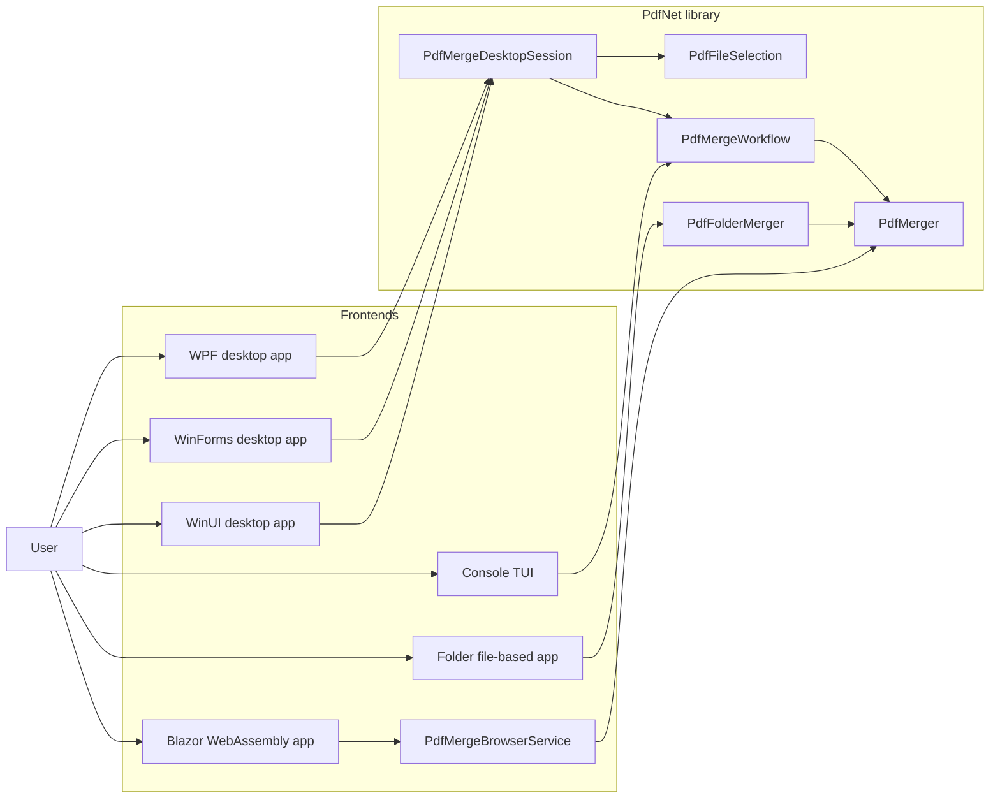
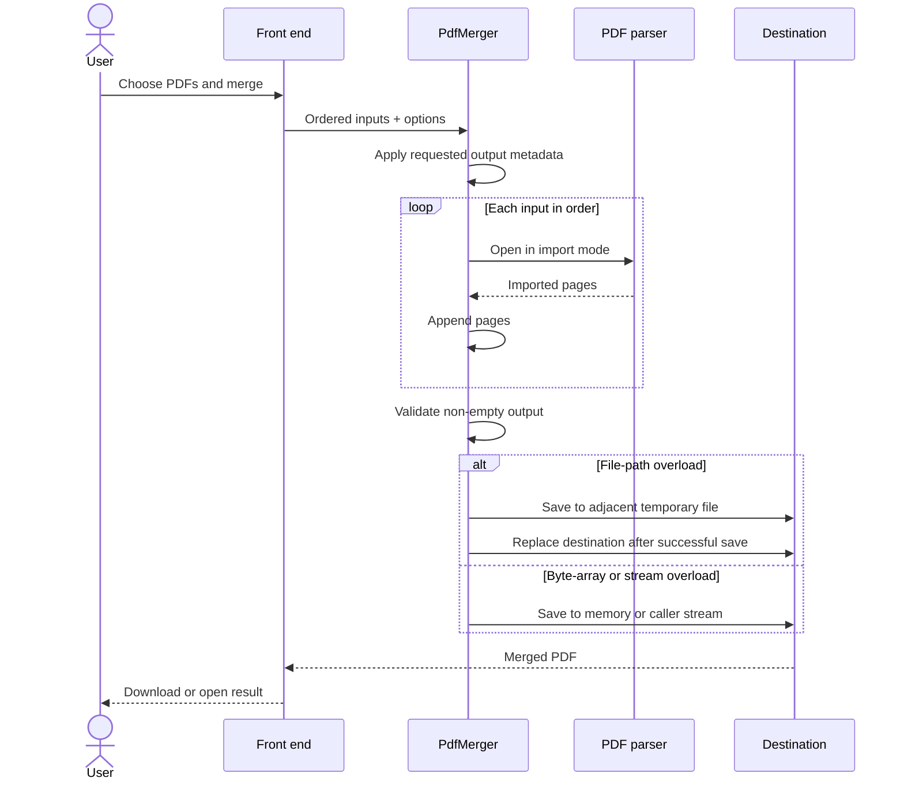

# Architecture

PdfNet is a dependency-free .NET 10 PDF-merging library with command-line and
desktop/browser front ends. All apps and shared workflows use `PdfNet`.

## Project map

| Project/file | Responsibility |
| --- | --- |
| `src/PdfNet` | Dependency-free core engine: PDF parsing, page/resource copying, metadata, and output generation. |
| `src/PdfNet.Tui` | Interactive terminal menu for selecting paths and merging to a destination. |
| `src/PdfNet.FolderMerge.cs` | .NET file-based app that merges top-level PDFs from one directory. |
| `src/PdfNet.Wpf` | Windows WPF UI for selecting, merging, and opening PDFs. |
| `src/PdfNet.WinForms` | Windows Forms UI with the same desktop workflow. |
| `src/PdfNet.WinUI` | Windows App SDK UI with the same desktop workflow. |
| `src/PdfNet.Wasm` | Standalone Blazor WebAssembly UI; reads, merges, and downloads files in the browser. |
| `tests/PdfNet.Tests` | xUnit library/workflow tests and bUnit WASM component tests. |



## Merge flow

`PdfMerger` exposes file-path, byte-array, and stream overloads. All routes
ultimately import each source document in order, append its pages, apply the
requested metadata, and serialize a non-empty result.



If a source file is missing, malformed, or empty when empty documents are not
configured to be skipped, merging fails. File-path merges preserve an existing
destination on merge failures by writing to a temporary file before replacement.
Stream callers retain ownership of their input and output streams.

## Application-specific behavior

- **TUI:** collects input paths and an existing output folder through a numbered
  menu, or accepts `--output <folder>` and ordered input paths through
  `PdfMergeCommand` (no arguments opens the menu). Command mode reports errors
  to stderr and returns a nonzero exit code. The interactive
  menu and command mode save `merged.pdf` inside that folder via `PdfMergeWorkflow` to protect
  selected inputs. Invalid folder entries preserve the previous destination. A move
  action that changes a PDF's numbered merge position; merge errors
  are displayed in red on an interactive terminal and the menu remains available.
  Both path prompts strip surrounding whitespace and matching single/double
  quotes; redirected output stays plain text.
- **Folder app:** finds only direct child files with a `.pdf` extension, sorts
  them deterministically by filename, excludes the destination, and defaults to
  `merged.pdf`.
- **WPF, WinForms, and WinUI:** use `PdfMergeDesktopSession` to maintain ordered,
  duplicate-free selections, including stable up/down movement of selected PDFs,
  and `PdfMergeWorkflow` to reject a destination matching an input and merge to
  a file. The UI launches the saved PDF with the system default viewer.
- **Blazor WebAssembly:** accepts at most 100 files, with 100 MB maximum per
  file and 200 MB combined. The picker accepts clicks and native file drops;
  selections must have a `.pdf` extension or PDF content type. Per-file up/down
  buttons set the merge order. All selection controls are disabled while merging.
  `PdfMergeBrowserService` lives in the WASM project, validates stream limits,
  and delegates PDF merging to the core library. The app reads files into browser
  memory, merges them
  using the stream API, and triggers a client-side `merged.pdf` download; there
  is no server-side upload endpoint.
  Each file-picker selection retains its original hidden input until all its
  selected files are removed or cleared, keeping Blazor file IDs valid when
  more files are added.

## Build and verification

From the repository root:

```bash
dotnet build src/PdfNet.slnx
dotnet test src/PdfNet.slnx
dotnet publish src/PdfNet.Wasm/PdfNet.Wasm.csproj -c Release
```

The WPF, WinForms, and WinUI applications target Windows. `EnableWindowsTargeting`
allows the WPF and WinForms projects to be built from non-Windows environments
that have the required targeting packs. The WinUI XAML compiler requires a
Windows build host.

For portable validation, run
`dotnet test tests/PdfNet.Tests/PdfNet.Tests.csproj`. bUnit tests render the actual
WASM `Home` component and cover retained inputs, ordering, validation, busy
states, real merged PDF output, and recovery from merge/download errors.
Native drag-and-drop hit testing and Blazor's JavaScript file IDs still need a
real-browser smoke test; bUnit does not execute those browser internals.
